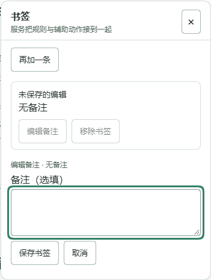

# D040 · 书签原位编辑与紧凑标注浮层回执

## 当前结论与入口

[4342 作者试读](http://127.0.0.1:4342/) 已运行受审候选 **`4653421`**，使用作者原先试写的项目。书签可在所点理由上编辑，切行或收起可找回各自草稿；三态标注即时保存状态，批注在原处单独保存。作者追加的「更多」现将移除按钮浮在本行操作图标旁，打开和收起时各条保持原位。

- 批准依据为 `b619b57` 的[派单](task.md)、[排版示意](reference.png)和[作者的菜单调整](amendments.md)。比较基线为 `dev@475b6b4`，版前实测构建对应 `013c6f6`。
- 自测及[独立审查](review.md)通过，审查已交还写入。作者已确认排版方向并指出旧菜单的位移，最终候选的实际手感待亲验。建议试读服务首块时点一次「⋯」，再试两条书签之间切换草稿、写批注时切换状态。
- 2026-11-22 作者指令「合并到dev」，已将候选 `6b2e527` 以合并提交 `119b335` 合入 `dev`。作者体验仍待亲验，功能分支及 4342 试读资源继续保留至验收和后续处置。推送和发布待另行授权。

## 依据与验证

**作者截图中的四条书签。** 1440 × 900 Edge，服务首块，第二条有草稿，在第三条点「更多」。改前浮层从 278 增到 323 CSS px，所点行从 32 增到 77，下一条顶边从 381.6875 移到 426.6875。最终版开关前后浮层都是 350 × 278，所点行都是 32，下一条顶边始终是 381.6875，层内滚动量都是 0。桌面与 390 px 触屏均逐行比较了开、关和初始坐标及宽高，变化 **0 CSS px**。点菜单内的删除才提交，Esc 先回该条「更多」，再回页边入口；触屏上的铅笔仍可独立点按。[四条记录的实测坐标](../../../../../.local/D040/run1/menu-final/menu.json)

| 追加调整前 | 最终候选 |
| --- | --- |
|  |  |

**版前与版后编辑窗。** Windows 11，Edge 158.0.4370.33，1440 × 900 CSS px。两版均从同一份输入副本进入 `src/service.mjs` 的首块 `zhidif44`，一条空理由书签、已理解且无批注，点铅笔或「编辑批注」后输入框聚焦。两轮采图均为零 PUT。表内宽高来自页面坐标，按钮宽高使用 CSS px；图片是实际渲染的原尺寸局部。

| 编辑状态 | 版前 | 最终候选 |
| --- | --- | --- |
| 书签 | 350 × 464，6 个按钮高 40 | **350 × 182.375**，4 个按钮高 32。「＋」「×」各宽 32，取消、保存各宽 46 |
| 标注 | 350 × 308，6 个按钮高 40 | **350 × 228.375**，6 个按钮高 32。关闭宽 32，三段各约 105，取消、保存各宽 46 |
| 书签实图 |  |  |
| 标注实图 |  |  |

[版前整窗、尺寸](../../../../../.local/D040/run1/before/) · [候选整窗、尺寸](../../../../../.local/D040/run1/reviewed/)。输入两行、保存、收起及切换页边入口时，原句两行的顶边分别保持 480.046875 和 510.4375，阅读区 scrollTop 为 0，下一块顶边为 568.828125 CSS px。[逐步几何记录](../../../../../.local/D040/run1/margin-aVLvHE/report.json)

**保存与恢复。** 在作者项目的隔离副本，已有 A、B 与新增草稿可分别找回。改回原话时提示消失，取消 B 保留 A 和新增项，空理由可收藏，有未保存改动的条目禁止移除。编辑与回访均按书签 ID。另一页先保存后，陈旧提交返回 409，可同时核对已存理由和自己的草稿，明确重试才覆盖。批注在写时切至「不理解」，磁盘仅更新状态；关闭后能续写，取消还原已存原话，显式保存和清空均已读盘核实。两类记录分别经 Windows 文件锁产生真实 422，原件保留，解锁重试成功。另以既有标注回归实走双页批注冲突、仅有批注的未标记块回访和清空后的磁盘结果。

**视口与轮廓。** 390 × 844 触屏模拟中，关闭、新增、铅笔、更多、移除、三个状态、编辑批注、取消和保存均至少 44 × 44。强制色中输入区外轮廓为 2 px，内层 textarea 无第二圈。Firefox 159.0 的实际绘制分别取到外壳 21 px、输入区 14 px、选中段及移除控件 9 px，已核 SVG 填充、边线、聚焦描边和实图。Edge、Firefox 和 Chrome 均跑过会打开长理由和更多菜单的编辑回归。[Edge 数据和实图](../../../../../.local/D040/run1/editors-js8ixJ/) · [Firefox 数据和实图](../../../../../.local/D040/run1/editors-y293wm/) · [Chrome 数据和实图](../../../../../.local/D040/run1/editors-iJrVk7/)

**可复跑检查。** 使用仓内 Node 24.11.1，依次运行 `npm run typecheck`、`npm run build`。将 `AFTERTASTE_READER_INPUT` 指向原始输入副本、`AFTERTASTE_BUILD` 指向固定构建、`AFTERTASTE_TEST_TASK` 指向新的任务运行目录，再用 Node 逐个运行 `tests/browser/margin-editors.mjs`、`reader-margin-records.mjs`、`bookmarks.mjs`、`understanding-marks.mjs`。书签原回归从 dist 取服务，该次构建 71 个文件已与固定目录逐项核对。导航、切篇、记录管理回归沿用本轮菜单调整前的通过记录，覆盖各自的回访和草稿路径。未跑全仓无关测试。实机软键盘、实际读屏器播报及作者主观体验待验。[运行目录](../../../../../.local/D040/run1/)

**规格与修复记录。** 在 006 用 Spec Kit v1.4.0 的 specify、plan、tasks 与生效模板增量维护 US6、FR-010/017、SC-008/016、研究、模型、quickstart 和 T079—081。分析时四项批准要求均有任务与验收，未发现冲突或待澄清项；implement 前置材料齐全，需求清单 16/16。沿用 010、012 保存契约。[使用说明](../../../../usage/file-reader.md#收藏讲解块与回访)

新增浏览器回归首次创建第二页失败，改用独立页面后跑通 409。可选确认文案触发精确可选属性类型检查，改成布尔确认态后通过。换版核验脚本按原始字节比对首页并仅规范动态 nonce，解决 CRLF 文本比较差异。以上各 1 轮。菜单原图已复现 45 px 位移，脱离文流后归零；触屏首测发现浮出位置覆盖铅笔，移到两个图标外侧后同一点击通过。各项均留有原始日志。[修复与验证记录](../../../../../.local/D040/run1/rounds.txt)

## 资源与交回

4342 沿用 `.local/D039/run1/preview/project`。换版前后逐份比对 15 个资料文件的 SHA-256，含个人记录、讲解、依赖图、闭环和布局。两个端口均核对了首页、实际项目路径、6 个静态资源及 12 个只读 API 响应。4341 仍运行 D038，4342 的新 JS、CSS 和字体与受审构建逐字节一致。换版后用 Edge 在 4342 实开「更多」并以两次 Esc 返回，写请求为 0。[换版前清单](../../../../../.local/D040/run1/pre.json) · [换版后清单](../../../../../.local/D040/run1/post.json) · [在线实测](../../../../../.local/D040/run1/live-4342.json)

4342 当前 PID 为 **14664**；4341 为 **3588**。原 D039 固定构建 `.local/D039/run1/build-r2`、新构建及试读项目均保留至作者验收和后续处置。已收束自测、独审临时服务与浏览器。运行原件在本机忽略目录，上述六张关键实图随仓交付。[新构建清单](../../../../../.local/D040/run1/build-final-sha256.json) · [自测输入清单](../../../../../.local/D040/run1/input-sha256.json)

如需手动重启，先确认 4342 空闲，在本仓根目录的 PowerShell 运行；输出 `"status":"ready"` 表示已就绪。

```powershell
& .local/D009/runtime/node.exe .local/D040/run1/build-final/cli/main.js serve --project (Resolve-Path -LiteralPath '.local/D039/run1/preview/project').Path --port 4342
```
