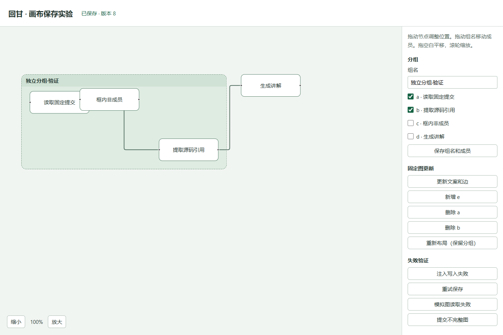
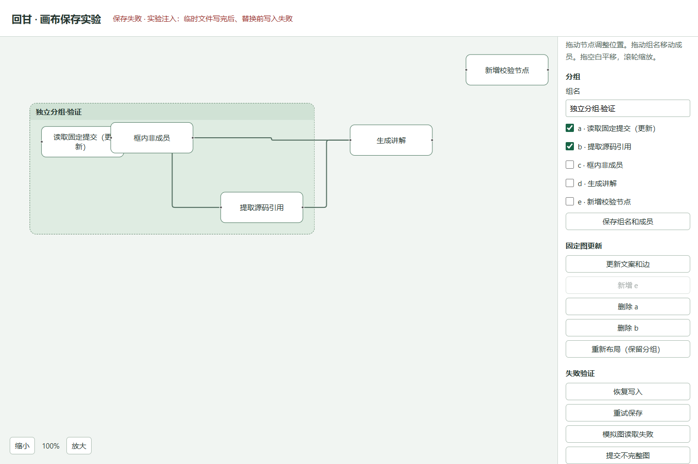

# D004 · 图画布自由布局与持久恢复

## 目标与依据

- 批准任务为 [task.md](../../docs/work/D004-canvas-persistence/task.md)，批准提交 `1fb8488`，认可 dev 基线 `79350b0`。本次无范围调整。
- 验证 08 的 R16、A17—A18，具体行为来自 04 的 U91—U93，技术路径来自 03 的 U102。通过条件沿用任务表格。
- 本目录提供合成图和本机实验服务。数据只写 `.local/<run-id>/`，构建写 `.local/build/`。采用协作实验 README 模板，未建立正式 spec／plan／tasks。
- 实现使用 Ponytail full。页面使用 Impeccable Operate 的常规控件、错误反馈及渲染检查。context 运行成功，detect 返回 `[]`。任务限定核心实验，因此省略完整视觉访谈、概念稿及额外 PRODUCT／DESIGN 文件。性质检查采用固定种子生成与 Node assert，未引入新的性质测试库。写入边界按 Sharp Edges 核查。

## 输入与复现

### 固定输入和依赖

[inputs/graph.json](inputs/graph.json) 为四节点、两条边的合成图。初始组为 `读取流程`，成员 `a、b`，`c` 完整位于背景范围内且为非成员。初始坐标由 [model.ts](src/model.ts) 的 `initialState` 给出。画布节点固定 170×64，以便核对实际边界。实验 UI 管理一个具名分组，应用模型采用单组归属。正式的分组交互与存储字段仍由后续设计确定。

| 项目 | 本次版本 |
| --- | --- |
| OS | Windows 11 家庭版 中文版，10.0.26200，x64 |
| 实验 Node | 24.22.3，实验目录 devDependency |
| 安装 npm / 宿主 Node | npm 11.6.4 / Node 22.23.2，仅用于安装引导 |
| Vue / Vue Flow | 3.5.45 / @vue-flow/core 1.48.2 |
| Vite / Vue 插件 | 8.3.8 / @vitejs/plugin-vue 6.0.11 |
| Fastify | 5.12.8 |
| TypeScript / vue-tsc | 5.9.3 / 3.1.1 |
| Playwright | 1.56.1，仅自动化驱动现有浏览器 |
| Edge 主验 | 157.0.4341.46，1440×960，headless 实际浏览器 |
| Chrome 兼容 | 157.0.8103.52，同尺寸、串行 |
| Firefox | 常用安装路径和 Playwright 缓存均未找到，未测试 |

Vue Flow、Vue 和 Fastify 为实验运行依赖。Vite／插件构建页面，TS／vue-tsc 做严格类型检查，Node devDependency 提供隔离的 Node 24，Playwright 驱动真实鼠标与浏览器生命周期。版本全部固定在 [package.json](package.json) 和 [package-lock.json](package-lock.json)，未修改全局 Node、安装浏览器或创建根产品工程。

### 准备、启动、停止

在 PowerShell 中执行。需要 npm 下载依赖，已有依赖下启动使用本机文件与现有浏览器。

```powershell
Set-Location 'D:/project/SpecDev Harness/aftertaste-reader/experiments/D004-canvas-persistence'
npm ci --no-audit --no-fund
npm run check
npm run build
npm test
$env:RUN_ID = 'author'
npm start
```

首次安装可由现有 Node 22 引导，项目 engines 会提示需 Node 24。npm 脚本随后优先使用本目录的 Node 24，可通过 `& './node_modules/node/bin/node.exe' --version` 核对。本次实际使用 `npm install --no-audit --no-fund` 生成锁文件，未另做干净机器重装。

启动后打开 [实验页面](http://127.0.0.1:4317/)。保存文件为 `.local/author/layout.json`，含修订号与当前图、节点坐标、组名／显式成员、视图平移与缩放。首次从固定输入初始化，保存成功后文件成为重开依据。服务只绑定 `127.0.0.1`，写接口校验 Host、Origin 和自定义头。可配置 `PORT` 和合法 `RUN_ID`，HTTP 请求无法选择磁盘路径。

停止时，在启动终端按 Ctrl+C。也可使用启动输出中的本实验 PID 执行 `Stop-Process -Id <PID>`。只停止该 PID。作者验收可先关闭实验页、停止服务，再以相同 RUN_ID 启动并重新打开。等待“已保存”后再关闭。

自动化入口如下，默认每次生成独立 RUN_ID，退出后关闭自己创建的页面、浏览器和服务。Edge 的三次重开每次都会重新创建浏览器上下文和服务进程。

```powershell
Remove-Item Env:BROWSER -ErrorAction SilentlyContinue
npm run browser
$env:BROWSER = 'chrome'
npm run browser
Remove-Item Env:BROWSER
```

不要在作者服务占用 4317 时运行自动化。脚本启动失败会报错。`HEADED=1` 可用于观看同一路径，本次取证采用 headless。浏览器脚本只使用实验新页面。

### 人工复现步骤

1. 拖动 a 到非默认位置，填写组名，点击“保存组名和成员”。拖动背景顶部组名，观察 a、b 同位移，框内 c 留在原位置。勾选／取消成员后应用，背景依据成员坐标重新计算。
2. 拖空白平移，滚轮缩放。待“已保存”后记录文件，关闭页面、停止服务、重启并打开，核对节点、组、视图。初始化不会 fitView 或重新排布。
3. 点击“更新文案和边”“新增 e”，核对旧位置不变、e 放在已有排布右侧。点击“模拟图读取失败”“提交不完整图”，错误出现且当前状态与旧文件保持。
4. 开启“注入写入失败”，拖动一个节点。状态显示“保存失败”，当前操作保留，旧文件可读且内容不变。点击“恢复写入”“重试保存”，再完整关闭重开，恢复新位置。
5. 点击“重新布局（保留分组）”，按组作为排布单位重算节点位置，组名和成员保持。删除 a 后 b 不移动，删除 b 后空组消失，其他节点不移动。再完整关闭重开。

## 结果与交回

### 证据和结果

固定实现提交在最终 [handoff](../../docs/work/D004-canvas-persistence/handoff.md) 记录，`evidence/source-hashes.json` 同时绑定实际取证源文件。必要原始证据已入库，普通运行产物位于下述忽略目录。

| 检查 | 实际结果和证据 |
| --- | --- |
| 类型／构建 | `npm run check`、`npm run build` 通过。构建产物 16 模块，JS 228.96 kB、CSS 8.52 kB，未做性能基准。 |
| 最小行为检查 | `npm test` 3 项通过。固定种子 4004 的 50 组坐标验证存续位置、重复更新幂等、增删、重排与边界。保存接口验证实际 JSON、注入失败保旧与清临时文件、重试、两个同版本并发请求返回 200／409、无效输入、跨源／Host 拒绝、读图失败及损坏文件保护。最后一轮 run 为 `checks-1794816313485`。 |
| A17 自由布局和组移动 | Edge 通过。a 拖动后位置改变，组名保存；所有成员同位移、c 不动；替换成员后实际 DOM 背景范围与计算值一致。[完整阶段记录](evidence/edge.json) |
| A17 关闭并恢复 | Edge 通过。关闭页面和浏览器、停止服务并确认端口不可访问，再开服务和全新浏览器，恢复前后 JSON 含 revision 完全一致，节点 DOM transform、组边界／名称、视图矩阵与磁盘一致。三次重开覆盖基础布局、失败重试后布局及增删后的布局。[进程记录](evidence/edge-server.log) |
| A17 图更新保留布局 | Edge 通过。文案及边更新保留旧位置；e 在原排布右侧；删除 a、b 不移动其他节点且空组消失，最后重开仍保持。读图失败与不完整图均保留状态和原文件。[阶段记录](evidence/edge.json) |
| 保存失败 | Edge 通过。正常保存和失败使用同一 `writeSaved`；在临时文件 sync 后、rename 前注入失败。界面显示失败，旧文件逐字一致，当前页面保留新坐标；恢复后重试，再停服务重开取到新布局。[旧文件与未保存输入](evidence/write-failure.json) |
| A18 重排保组 | Edge 通过。默认排布按每组一列、未分组节点依次右排，保留组名／成员，模型检查还覆盖重排幂等。实现为 model.ts 的 `rearrange` 与一个按钮，可低成本保留分组。 |
| Chrome 兼容 | 拖节点、命名、拖组且非成员不跟随、平移缩放、关闭页面和服务后恢复均通过。[Chrome 原始记录](evidence/chrome.json) |
| 视觉核对 | 已查看恢复后和写入失败截图，确认画布、背景、控件、状态可见。Impeccable detect 返回空发现。截图如下。 |





原始输出为 `.local/browser-msedge-1794816540630/` 与 `.local/browser-chrome-1794816553108/`，包括更多截图、JSON 和服务日志。版本化 evidence 已保留必要取证数据，克隆后可查看并通过脚本重新生成新一轮输出。

初版浏览器断言把完整鼠标行程当作组件节点位移。实际 Vue Flow 拖动阈值会略去起始行程，核源码后改为检查成员相同的实际位移和非成员不动，符合原批准条件。起拖基准同步改为已保存的组边界。滚轮检查最初早于 move-end，已改成同时等待磁盘、页面状态和实际渲染一致。失败运行仍在对应 `.local/browser-msedge-*` 中。类型检查期间修正了错误类型标注。没有遗留连续两轮修复仍失败的问题。

### 技术结论和限制

- Vue Flow 提供节点拖动、连线呈现、平移缩放、事件和视图设置。应用代码提供显式成员、组背景边界及同位移移动、图更新协调、简单保组重排、保存队列与状态。Fastify 和 Node 文件接口完成本地恢复链路。
- 当前技术路径满足本实验 A17 和 A18 行为。建议正式实现沿用 Vue Flow、全局节点坐标、显式成员与自动计算背景；重排保留组名和成员已有低成本实现证据，可由主脑纳入正式设计。
- 保存先写临时文件、sync、close、rename，再向页面确认成功。单页面将新状态顺序保存，服务串行写入并按 revision 拒绝过期覆盖。实验限定单服务、同一图，多个服务同时写同目录与断电持久性未验证。正常关闭与停止进程恢复已经验证。
- 分组 UI 只管理一个组、节点固定尺寸，默认排布追求可判断行为。嵌套组、多组交互、复杂避让、大图性能、完整阅读器、导出及安装体验均留给对应正式任务。Firefox 未测，作者体验待验。
- 本实验将合成图和布局写在一个 envelope，目的是在同一次保存中核对图更新结果，不能作为正式产品的存储协议定稿。未修改现行产品规格，也未把其他产品验收项标为完成。

官方接口核查使用 [Vue Flow 状态](https://vueflow.dev/guide/vue-flow/state.html)、[配置](https://vueflow.dev/guide/vue-flow/config.html)、[节点](https://vueflow.dev/guide/node.html)、[Vite 兼容要求](https://vite.dev/guide/)、[Node 24 文件接口](https://nodejs.org/docs/latest-v24.x/api/fs.html)，并核对安装版本的类型声明和拖动源码。官方说明用于选接口，行为结论由上述实际操作与文件证据给出。

独审原文与最终交回统一见 [任务 handoff](../../docs/work/D004-canvas-persistence/handoff.md)。
